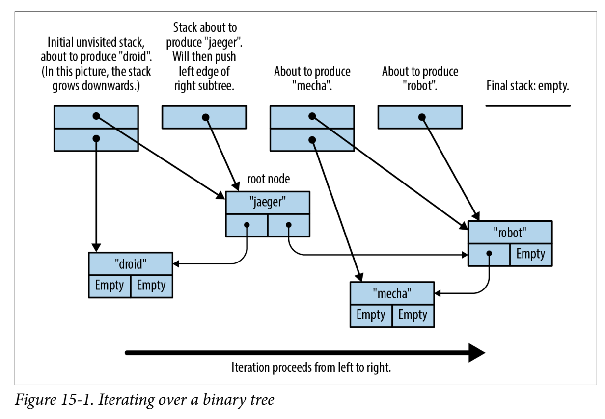

Last Lesson Leftovers
===
# Into/TryInto
Into a type. Try into a type `try_into() -> Result<T, E>`

<!-- pause -->
# From/TryFrom
Always prefer `From` as it also gives you `Into`.

<!-- pause -->
```rust +line_numbers
impl<'a, E: Error + Send + Sync + 'a> From<E>
    for Box<dyn Error + Send + Sync + 'a> {
        fn from(err: E) -> Box<dyn Error + Send + Sync + 'a> {
            Box::new(err)
        }
    }

```

Collections
===
Basic collections:
<!-- incremental_lists: true -->
- Vectors - `Vec<T>`
- Vector Double-ended queue `VecDeque<T>`
- Binary Heap - `BinaryHeap<T>`
- Hash Maps - `HashMap<K, V>`
- Binary Tree Map - `BTreeMap<K, V>`
- Hash Set - `HashSet<T>`
- Binary Tree Set - `BTreeSet<T>`
- Linked List - `LinkedList<T>`

Iterators
===
# Traits
- Making items iterable
- Traits `Iter` and `IntoIter`

<!-- pause -->

```rust +line_numbers
let v = vec![10, 40];

let mut iterator = v.iter();
assert_eq!(iterator.next(), Some(&10));
assert_eq!(iterator.next(), Some(&40));
assert_eq!(iterator.next(), None);
// ...
```

<!-- pause -->
# Functions
<!-- incremental_lists: true -->
- `into_iter()` -> for x in vector {}
- `iter_mut()` -> for x in vector.iter_mut() {} | for x in &mut vector {}
- `iter()` -> for x in vector.iter() {} | for x in &vector {}

Ranges
===
Uses the `std::ops::*`
<!-- incremental_lists: true -->
- `Range` -> x..y => <x, y)
- `RangeInclusive` ->x..=y => <x, y>
- `RangeFrom` -> x.. => <x, INF) - this can panic if overflowing or reaching limit
- `Option<T>` or `Result<T, E>` -> Some(10).iter() - we get Some(v) or None (vector of len 1)
- `Vec<T>` -> v.windows(16), v.chunks(16), v.split(|_| ), ...
- `std::iter::repeat("#2")` -> produces a value forever

Operations on iterators
===
Point is to consume iterators and produce different iterators. Functional programming style.
<!-- incremental_lists: true -->
- `map()` and `filter()`
- `chain(&iterator)` - appends one iterator to the end of another
- `take()`
- `fuse()`
- `inspect()` - useful debugging tool.
- `enumerate()`
- `zip()`
- `cloned()` and `copied()`
- `cycle()` - produces an endless cycle. Requires `Clone`.
- `rev()` - require an iterator to be `DoubleEnded`.


```rust
trait DoubleEndedIterator: Iterator {
    fn next_back(&mut self) -> Option<Self::Item>;
}

trait ExactSizeIterator: Iterator {
    fn len(&self) -> usize { ... }
    fn is_empty(&self) -> bool { ... }
}
```

Consuming Iterators
===
<!-- incremental_lists: true -->
- `count()` -> iterator => consumes values => outputs count (u32)
- `sum()` -> iterator => consumes values => outputs sum (u32)
- `product()` -> ...
- `max_by()`, `min_by()`
- `any()`, `all()` -> very useful
- `fold()` -> a.iter().fold(1, |n, i| n*i) // product
- `nth()`, `first()`, `last()`, `find()`
- `for_each()`
- `collect()` -> creates a collection. Used usually with turbofish syntax: `.collect::<Vec<_>>()`



Iterator Examples
===

# Example using splitting
```rust +line_numbers
// Split according to whitespace
let split = input
    .split(|x| *x == 0)
    .map(|x: &[u8]| String::from_utf8(x.to_vec()).expect("input is not UTF-8!"))
    .collect::<Vec<String>>();

let compressed_contents = split[2..].join(" ");
```
<!-- pause -->

# Example on GitHub
[](https://github.com/medzernik/codecrafters-git-rust/blob/main/src/main.rs)


Smart Pointers
===

# Box\<T>

Allocate a stack-based or unsized variable on Heap.

```rust
let x = Box::new(4);
println("{}", *x);
```

<!-- pause -->

# Rc\<T>/Arc\<T>
Reference counting - moving borrow checking to runtime. The `Drop` trait decrements the counter.
Proper 'free' is called once the counter reaches 0.

<!-- pause -->
> [!CAUTION]
> Moving the borrow checking to runtime does NOT make it easier nor does it loosen any requirements.
> You need to upkeep invariants, and can panic at runtime!

<!-- pause -->

```rust
impl Node {
    fn append_to(self: Rc<Self>, parent: &mut Node) {
        parent.children.push(self);
    }
}
```

Cell\<T>
===
Setting data using non-mutable reference access:

```rust +line_numbers
let cell: Cell<u32> = Cell::new(5);
let val = Cell::get();
// I don't have a `mut` ref here, works.
Cell::set(val+1);
// .. but I can't call mut methods on the type..
```


RefCell\<T>
===
Borrowing at runtime:

```rust +line_numbers
let ref_cell: RefCell<String> = RefCell::new("hi".to_string());
let borrow = ref_cell.borrow();
//let mut_borrow = ref_cell.borrow_mut(); --> crashes
if let Ok(val) = ref_cell.try_borrow_mut() {
    // something here...
}
```

Fin
===

Go do the tasks :D
