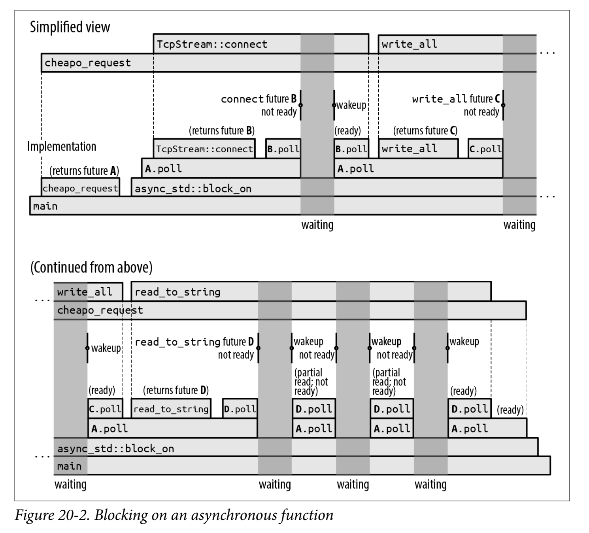
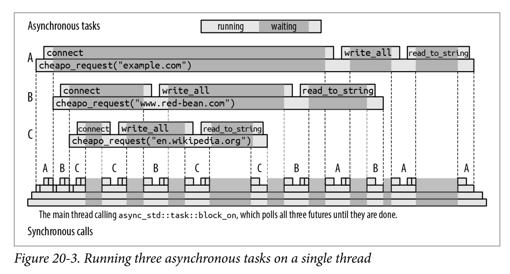

News
===
<!-- incremental_lists: true -->
- The subject is APPROVED AND LIVE ON KOS
- GO SIGN UP
- 5 credits, Z + ZK
- for both I. and II. level of studies

Concurrency
===
<!-- incremental_lists: true -->
- working on multiple things during overlaping time segments
- aka starting work on task B before finishing task A
- parallelism is a form of concurrency
- concurrency != parallelism

Asynchrony
===
<!-- incremental_lists: true -->
- "lack of synchrony" aka lack of predictable, predetermined, linear occurence of events
- in practice, it generally refers to occurence of events that happen at "random" (random as in random access) times
- reactions to these events generally occur outside of the main program flow (sometimes there is no real main program flow)
- reactions to these events are generally concurrent

Tasks
===
<!-- incremental_lists: true -->
- a unit of work that is executed asynchronously
- has to be driven to compeltion by an **executor**/ **runtime** that manages tasks
- "green threads" aka userspace threads

Cooperative Multitasking
===
<!-- incremental_lists: true -->
- multitasking on most modern OSs is preemptive (the scheduler pauses a task without asking)
- in cooperative multitasking, a task is paused only at specific points programmed in the task (the task has to **yield**s execution)
- Rust's (like most other programming languages') async programming model relies on **cooperative multitasking**

